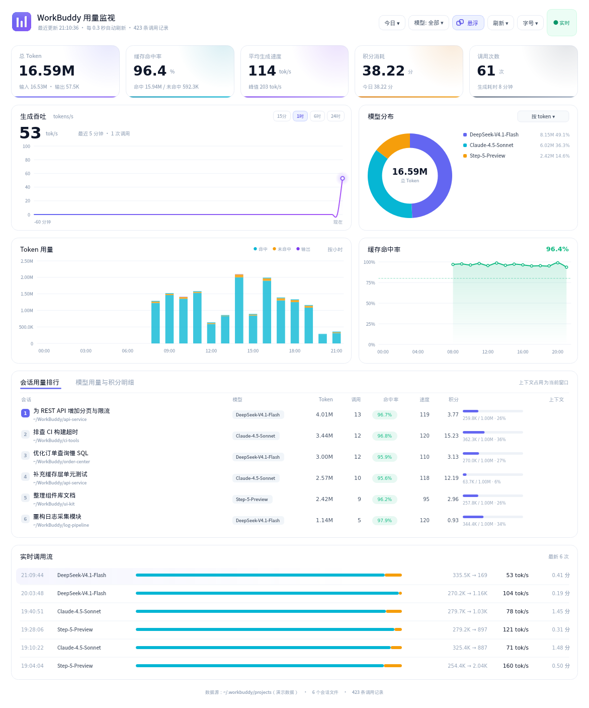

# WorkBuddy 用量监视 · Windows 版

Windows 上开箱即用的 WorkBuddy 用量面板：一键装好、原生窗口、不依赖浏览器内核。


> **来源声明**
> 本项目是 [The-garden-of-sinner/workbuddy-token-monitor](https://github.com/The-garden-of-sinner/workbuddy-token-monitor)
> 的 **Windows 适配版**，基于上游 `v1.1.2`，遵循 MIT 许可证，原作者版权完整保留。
> 详见 [LICENSE](LICENSE) 与 [NOTICE](NOTICE)。
>
> 上游面向 Linux 桌面（`.deb` 安装包、桌面菜单项），本仓库只做 Windows 侧的打包与适配，
> **核心采集逻辑与指标口径未做任何改动**。



## 为什么单独一个仓库

上游的启动链路是 `run.sh` + `.desktop` + `dpkg`，在 Windows 上完全用不了；
而 Windows 侧还有两个上游不需要处理的问题（批处理编码、Qt 的中文路径限制）。
把这些打包逻辑独立出来，上游保持干净，这边可以自由迭代。

## 快速开始

### 方式一：单文件安装（推荐）

下载 [`install-win.bat`](install-win.bat) 双击，一路到底：

```
找 Python 3.8+ → 取源码 → 装到 %LOCALAPPDATA%\WorkBuddyTokenMonitor
→ 建虚拟环境 + 装 PyQt5 → 桌面快捷方式 → 启动面板
```

以后从桌面快捷方式打开即可。重跑这个文件就是「更新/修复」。

### 方式二：源码运行

```bat
git clone git@github.com:mxxnpu/workbuddy-token-monitor-win.git
cd workbuddy-token-monitor-win
run-win.bat
```

首次运行会自动建环境、装 PyQt5（约 60 MB），之后秒开。

命令行开关：

| 命令 | 作用 |
| --- | --- |
| `run-win.bat` | 打开原生桌面面板 |
| `run-win.bat --web` | 启动本地服务并用浏览器打开 `http://127.0.0.1:8791` |
| `run-win.bat --stop` | 停止后台服务 |
| `run-win.bat --console` | 前台运行，错误可见（排障） |

其余参数透传给 `qt_app.py`：`--range 7d`、`--model <名称>`、`--demo`、`--shot out.png`。

## 与上游的差异

| 项目 | 上游 (v1.1.2) | 本仓库 |
| --- | --- | --- |
| 平台 | Linux 桌面 | Windows 10 / 11 |
| 字体 | 硬编码 `Droid Sans Fallback` / `DejaVu Sans` | 按可用性挑选：`Noto Sans SC` → `Source Han Sans SC` → `Microsoft YaHei UI` → `PingFang SC`，替代字体自动抬到 Medium 字重 |
| 启动 | `run.sh`（bash） | `run-win.bat`（纯 ASCII + CRLF） |
| 安装 | `build_deb.sh` → `dpkg -i` | `install-win.bat`（单文件、自动建环境、建快捷方式） |
| 虚拟环境 | 系统 `python3-pyqt5` | `%LOCALAPPDATA%\WorkBuddyTokenMonitor\venv`（纯 ASCII 路径，规避 Qt5 限制） |
| 文档 | `README.md`（中文）+ `README.en.md` | `README.md`（本文件）+ [`README_windows.md`](README_windows.md)（Windows 细节与排障） |
| Linux 打包脚本 | 有 | 已移除（`build_deb.sh` / `release.sh` / `setup_token.sh` / `install.sh` / `run.sh` / `stop.sh`） |

Windows 上有一个坑值得单独说：**PyQt5 不能装在含中文的路径下**，
否则 `QApplication` 初始化会直接 `0xc0000409` fail-fast，且没有任何错误输出。
所以虚拟环境固定建在 `%LOCALAPPDATA%` 下，项目本身放中文目录倒是没关系。
细节见 [`README_windows.md`](README_windows.md#一个必须知道的坑pyqt5-不能装在中文路径下)。

## 目录

```
workbuddy-token-monitor-win/
├── install-win.bat      单文件安装器
├── run-win.bat          源码目录启动器
├── qt_app.py            桌面面板（PyQt5 + QPainter 手绘）
├── server.py            采集与聚合（仅标准库）+ 可选 HTTP 服务
├── web/                 Web 面板（原生 Canvas，无 CDN）
├── demo_data.py         演示数据（截图用，不读磁盘）
├── export_preview.py    导出单文件 HTML 快照
├── make_icon.py         生成图标
├── README_windows.md    Windows 详细说明与排障
├── NOTICE               来源与署名
└── LICENSE              MIT
```

## 数据来源

全部只读，不联网、不上传：

| 路径 | 内容 |
| --- | --- |
| `%USERPROFILE%\.workbuddy\projects\**\*.jsonl` | 每次调用的 usage（token、缓存命中、积分、时间戳） |
| `%USERPROFILE%\.workbuddy\workbuddy.db` | `sessions` / `session_usage`（会话标题、上下文占用） |

数据库以只读方式打开，不可用时自动降级，只显示 jsonl 里的信息。

## 许可与致谢

- 本仓库代码遵循 **MIT**，原版权归 `The-garden-of-sinner` 所有。
- 数据采集与界面设计均为上游成果，本仓库仅做 Windows 适配。
- 字体回退用到的 `Noto Sans SC` 遵循 SIL Open Font License，不随仓库分发。
